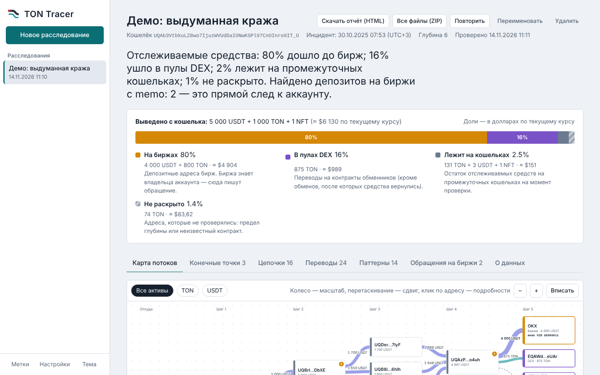
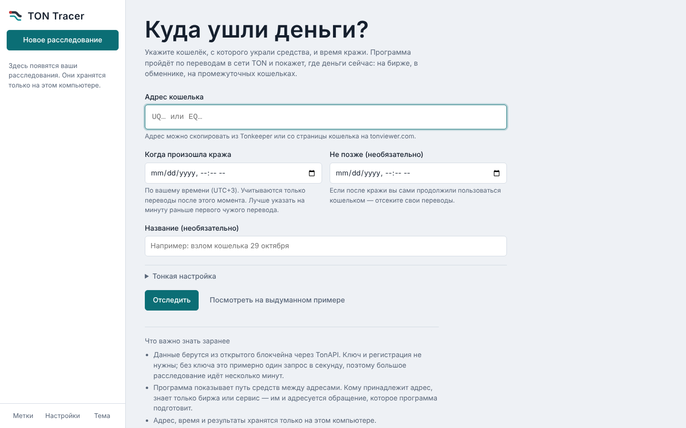
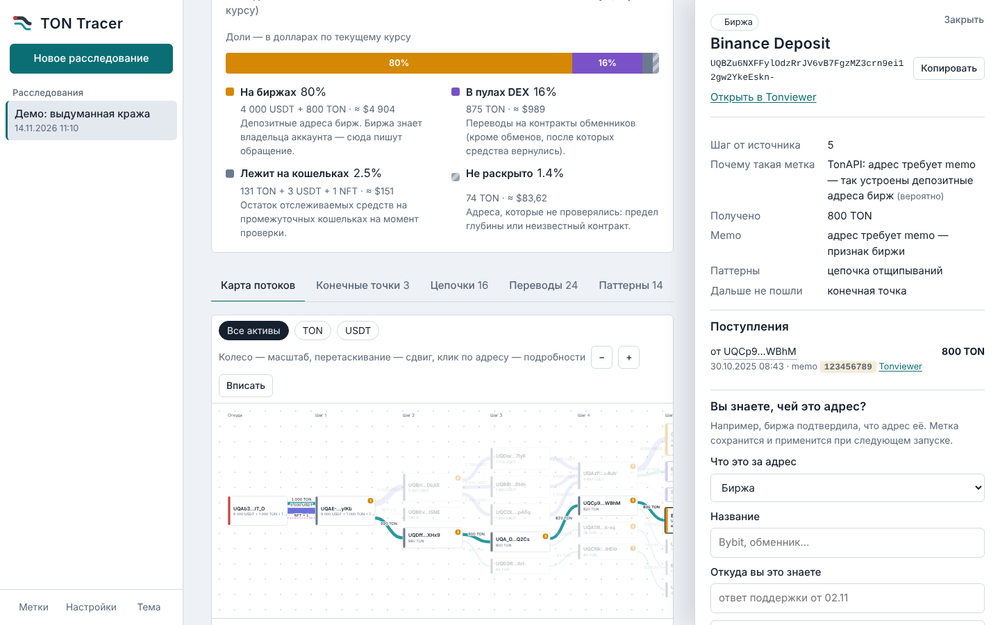
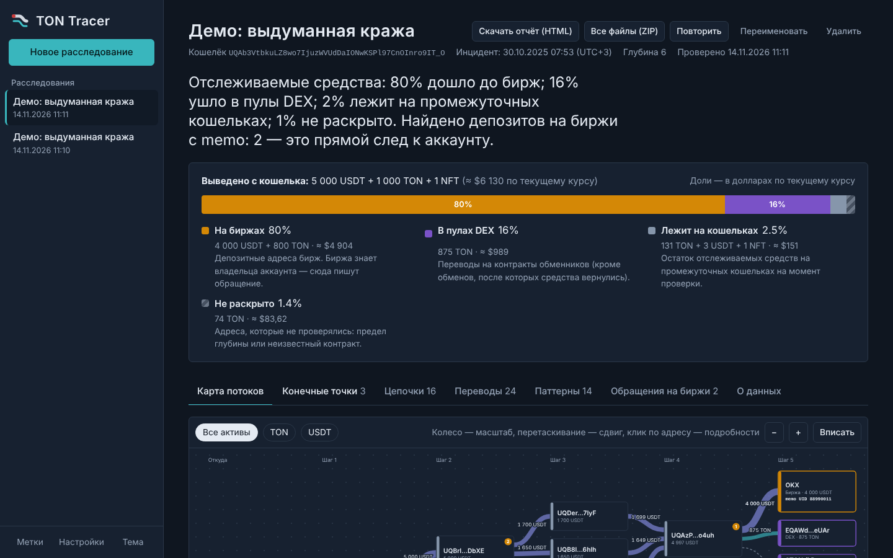

# TON Tracer

Приложение для ПК, которое отвечает на один вопрос: **куда ушли деньги, украденные с кошелька в сети TON**.

Вы указываете кошелёк и время кражи. Программа идёт по переводам в блокчейне и показывает,
какая часть средств дошла до бирж (с номерами memo депозитов), какая ушла в обменники и мосты,
какая лежит на промежуточных кошельках и где след оборвался. Для каждой биржи готовит текст обращения.



| Запуск | Карточка адреса | Тёмная тема |
|---|---|---|
|  |  |  |

Скриншоты сняты на встроенном демо-сценарии — адреса в нём выдуманные.

## Что умеет

- **Карта потоков.** Слева исходный кошелёк, каждый столбец — следующий шаг. Толщина линии — сумма.
  Клик по адресу открывает карточку: что пришло, что ушло, что осталось, почему дальше не пошли.
- **Учёт украденной суммы.** Если кошелёк получил 85 TON от вора, а потом потратил 500 своих,
  программа проследит дальше только 85. Граф не зарастает чужими деньгами.
- **Обмены на DEX.** Украденные USDT обменяли на TON — программа продолжит следить уже за TON.
- **Ответ в процентах.** «80% дошло до бирж, 16% в пулах DEX, 2% лежит на кошельках, 1% не раскрыто» —
  с суммами по каждому активу и оценкой в долларах по текущему курсу.
- **Memo депозитов.** Номер, по которому биржа зачисляет перевод на конкретный аккаунт, — главный след.
- **Обращения на биржи.** Готовый текст на русском и английском со ссылками на транзакции.
- **Паттерны.** Цепочки отщипываний, дробление, консолидация, транзитные кошельки.
- **Свои метки.** Узнали, что адрес принадлежит бирже, — пометьте его, и метка применится ко всем расследованиям.
- **Экспорт.** Отчёт одним HTML-файлом (открывается без интернета и без программы), таблицы CSV, сводка, JSON.
- **История.** Расследования сохраняются на вашем компьютере, к ним можно вернуться.

## Установка и запуск

Нужен Python 3.10 или новее.

**Windows:** скачайте репозиторий и запустите `start.bat` двойным кликом.

**macOS и Linux:**

```bash
git clone https://github.com/doksek/ton-tracer.git
cd ton-tracer
sh start.sh
```

Или вручную:

```bash
python -m venv .venv
.venv/bin/pip install -r requirements.txt        # Windows: .venv\Scripts\pip
.venv/bin/python -m app
```

Программа откроется во вкладке браузера. Чтобы она открывалась отдельным окном, поставьте ещё
`pip install -r requirements-window.txt` (на Linux для этого нужны системные пакеты GTK или Qt —
см. документацию pywebview).

Первым делом нажмите **«Посмотреть на выдуманном примере»** — увидите все экраны без интернета.

### Без окна

```bash
python -m app.cli UQ...адрес --incident "2026-10-29 14:00" --depth 6 --out out
python -m app.cli --demo --out demo_out
```

Время в командной строке — UTC. В окне программы — ваше местное.

### Готовый исполняемый файл

`python build_app.py` (нужен `pip install pyinstaller`) собирает один файл в `dist/`.
Если отправить в репозиторий тег `v2.0.0`, GitHub Actions соберёт файлы для Windows, macOS и Linux
и приложит их к релизу.

## Источник данных и его ограничения

Единственный источник — **TonAPI** (`tonapi.io/v2`), публичный индексатор сети TON, на котором работает Tonviewer.

- Ключ и регистрация не нужны. Без ключа TonAPI отвечает примерно на один запрос в секунду,
  поэтому большое расследование идёт несколько минут. Бесплатный ключ с tonconsole.com можно
  вставить в настройках — станет быстрее.
- Ответы сохраняются на диске на 6 часов, повторный запуск почти не ходит в сеть.
- Метки бирж и сервисов TonAPI неполны. Неподписанный горячий кошелёк биржи будет выглядеть как
  «хаб» или обычный кошелёк. У каждой метки указано, на чём она основана и насколько ей можно верить.
- Курсы — текущие, а не на момент кражи.

## Как читать результат

- Это **граф переводов, а не доказательство владения**. Промежуточный кошелёк может принадлежать
  постороннему: обменнику, продавцу, участнику P2P-сделки.
- «Отслеживается» — оценка. Считается, что украденные средства уходят с кошелька первыми.
  В настройках запуска можно включить старый режим «по всем переводам».
- Адрес с очень большим числом операций считается хабом и не раскрывается: дальше деньги смешаны с чужими.
- Неизвестные смарт-контракты по умолчанию не раскрываются.
- Каждую транзакцию можно проверить по ссылке на Tonviewer.

## Допустимое использование

Программа сделана для расследования краж: у себя или по просьбе пострадавшего.

- Она работает только с открытыми данными блокчейна: адреса, суммы, время, комментарии к переводам.
- Она **не устанавливает личности** владельцев кошельков и не содержит для этого функций.
  Кто стоит за депозитным адресом, знает только биржа — и раскрывает это полиции по запросу.
- Не используйте результаты для публичных обвинений конкретных людей: совпадение в графе — не доказательство.
- Адреса, расследования и ключ хранятся только на вашем компьютере (`~/.ton-tracer`) и никуда,
  кроме запросов к TonAPI, не отправляются. Сервер программы слушает только `127.0.0.1`.

## Что делать, если у вас украли средства

1. Запустите расследование как можно раньше и сохраните отчёт.
2. Подайте заявление в полицию, приложите отчёт и ссылки на транзакции.
3. Отправьте бирже обращение из вкладки «Обращения на биржи», указав номер заявления.
   Биржа не вернёт деньги по письму, но может приостановить вывод и сохранить данные.
4. Не платите «специалистам по возврату», которые сами выходят на связь, — это частая вторая волна обмана.

## Устройство

```
app/
├── __main__.py        запуск окна:  python -m app
├── cli.py             запуск без окна
├── pipeline.py        одно расследование от параметров до результата
├── collectors/tonapi.py   клиент TonAPI: паузы, повторы, кэш
├── core/              адреса, метки, пути к данным
├── analysis/
│   ├── tracer.py      обход графа и учёт украденной суммы
│   ├── heuristics.py  паттерны
│   └── summary.py     распределение, цепочки, обращения
├── storage.py         SQLite: расследования, метки, настройки
├── report.py          экспорт: HTML, CSV, ZIP
├── demo.py            выдуманный сценарий для демо и тестов
└── web/               сервер (Flask) и интерфейс (HTML, CSS, JS без сборщиков)
tests/                 pytest — работает без интернета
```

Тесты: `pip install -r requirements-dev.txt && pytest`.

## Планы

- Поиск источника пополнения кошельков-прокладок (откуда пришёл газ).
- Курс на дату кражи.
- Импорт и экспорт меток файлом.

## English

**TON Tracer** is a local desktop app that follows funds stolen from a TON wallet. Enter the wallet
and the time of the theft; it walks outgoing transfers via TonAPI (no API key required) and shows
where the money ended up: exchange deposits with memos, DEX pools, bridges, intermediate wallets,
and where the trail stops. It tracks only the stolen amount through each wallet (so unrelated funds
do not flood the graph), follows DEX swaps into the new asset, detects peel chains, splits and
consolidation, and drafts freeze requests for exchanges. Everything runs on `127.0.0.1` and stays
on your machine. The interface is in Russian.

Run: `pip install -r requirements.txt && python -m app`. License: MIT.

The tool shows transfers between addresses. It does not identify wallet owners, and a path in the
graph is not proof of ownership.
